# Actividad 1: Definición del Problema y Accesos

## 1. Escenario y Usuarios

* **Escenario:** Catálogo de comercio electrónico para productos heterogéneos (moda, electrónica, calzado) con variantes (talla, color, especificaciones), control de stock por variante y sistema de valoraciones.
* **Usuarios:**
  * **Comprador:** Navega por el catálogo, filtra por características, consulta detalles de productos, lee opiniones y realiza compras.
  * **Administrador:** Gestiona el catálogo creando y actualizando productos, precios y categorías.
  * **Sistema de Inventario:** Consulta disponibilidad en tiempo real y descuenta stock automáticamente.

## 2. Preguntas de Negocio

1. **P1:** ¿Qué productos activos pertenecen a una categoría concreta dentro de un rango de precio específico?
2. **P2:** ¿Cuáles son las variantes, especificaciones técnicas y resumen de valoración de un producto determinado?
3. **P3:** ¿Existe disponibilidad de stock (> 0) para una variante o código específico al momento de comprar?
4. **P4:** ¿Cuáles son las reseñas más recientes de un producto ordenadas cronológicamente?
5. **P5:** ¿Qué variantes de productos activos se encuentran en nivel crítico de inventario (stock disponible $\le$ 5)?
6. **P6:** ¿Cuál es la valoración media acumulada y el número de opiniones por categoría de producto?

## 3. Frecuencia de Lecturas y Escrituras

* **Alta frecuencia de lectura (~90% del tráfico):**
  * Búsqueda y navegación en listados de catálogo (P1).
  * Carga de fichas de producto (P2).
  * Consulta de opiniones (P4).
* **Alta frecuencia de escritura:**
  * Actualización y descuento atómico de unidades en stock (`variantes.stock.cantidad_disponible`) tras una compra (P3).
* **Baja frecuencia de escritura:**
  * Alta y edición de fichas de catálogo por administradores.
  * Publicación de nuevas opiniones por compradores.

## 4. Matriz de Preguntas de Negocio y Accesos

| Pregunta | Colección(es) | Filtros (`find` / `$match`) | Ordenación (`sort`) | Paginación / Límite |
| :--- | :--- | :--- | :--- | :--- |
| **P1. Catálogo por categoría y precio** | `productos` | `{ estado: "activo", ruta_categoria: /^,electronica,/, "variantes.precio": { $lte: 700 } }` | `{ "resumen_valoraciones.media": -1 }` o `{ "variantes.precio": 1 }` | `limit: 20`, `skip: N` |
| **P2. Ficha de producto** | `productos` | `{ _id: ObjectId(...) }` o `{ codigo: "..." }` | No requiere | 1 documento |
| **P3. Disponibilidad de stock** | `productos` | `{ "variantes.codigo": "...", "variantes.stock.cantidad_disponible": { $gt: 0 } }` | No requiere | 1 variante |
| **P4. Últimas reseñas** | `resenas` | `{ id_producto: ObjectId(...) }` | `{ fecha_creacion: -1 }` | `limit: 5`, `skip: N` |
| **P5. Alerta de stock bajo** | `productos` | `{ estado: "activo", "variantes.stock.cantidad_disponible": { $lte: 5 } }` | `{ "variantes.stock.cantidad_disponible": 1 }` | `limit: 50` |
| **P6. Métricas por categoría** | `productos`, `categorias` | Agrupación con `$group` por `id_categoria` | `{ valoracion_media: -1 }` | Sin paginar |

## 5. Requisitos del Sistema (Explicados de forma sencilla)

* **Seguridad (Quién puede hacer qué):**
  * Un cliente o la tienda web no debe poder cambiar el precio de un producto ni borrarlo; solo puede mirar el catálogo y restar unidades de stock cuando compra.
  * Solo los administradores con contraseña pueden crear, editar o borrar productos y categorías.

* **Privacidad (Cuidar los datos de la gente):**
  * En las opiniones no guardamos ni el nombre real, ni el correo, ni el teléfono del comprador; solo se guarda un código anónimo (`id_usuario`). 
  * Así, si alguien lee las reseñas, no puede saber quién las escribió en la vida real.

* **Disponibilidad (Que la tienda nunca se caiga):**
  * La base de datos no está en un solo ordenador. Usamos tres copias idénticas a la vez: una principal que atiende las visitas y dos de respaldo.
  * Si el servidor principal se rompe o se apaga, uno de los de respaldo toma el relevo automáticamente al segundo y la tienda sigue abierta sin que el cliente note nada.

* **Crecimiento (Que el sistema no reviente con el tiempo):**
  * Un producto muy vendido puede llegar a tener miles de opiniones. Si metiéramos todas las opiniones dentro de la misma ficha del producto, el archivo se haría gigantesco y superaría el límite de tamaño que permite MongoDB (16 MB).
  * Por eso guardamos las reseñas en un "cajón" aparte (`resenas`), para que la tienda cargue rápido aunque haya 50.000 comentarios.
  
---
---

# Actividad 2: Diseñar las colecciones

## 1. Esquema y Propósito de las Colecciones

Para resolver el catálogo con atributos variables se estructuran tres colecciones:

* **`categorias`:** Almacena la taxonomía (secciones y departamentos). Permite crear o renombrar categorías sin modificar los documentos de los productos.
* **`productos`:** Colección principal del catálogo. Almacena las características técnicas flexibles e **incrusta** sus variantes de venta (tallas, colores) junto a su stock.
* **`resenas`:** Colección independiente referenciada por el identificador del producto (`id_producto`), diseñada para soportar un volumen ilimitado de opiniones sin penalizar el tamaño del producto.

### Diagrama del Modelo Físico

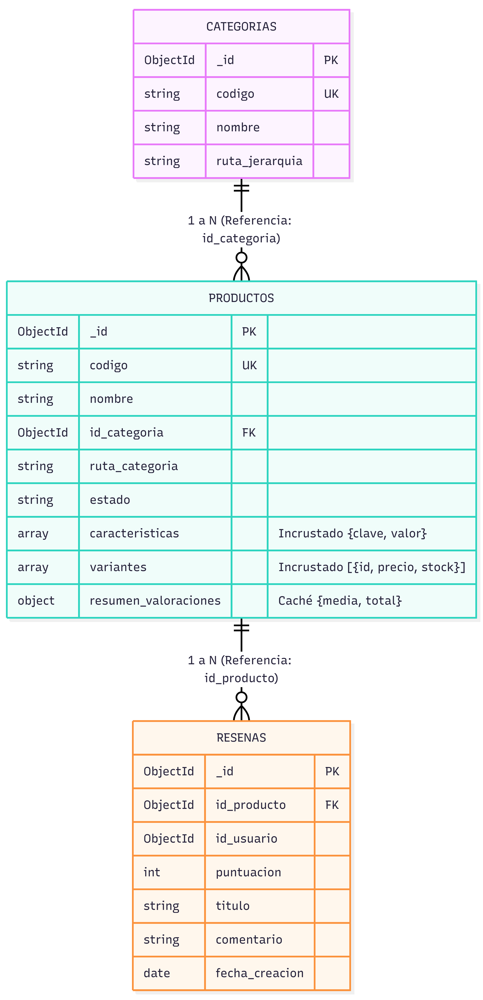
*Figura 0: Diagrama del Modelo Físico.*

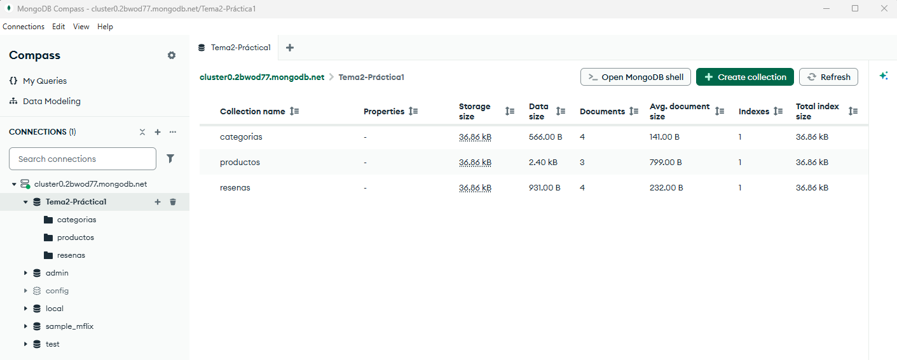
*Figura 1: Evidencia de las colecciones categorias, productos y resenas creadas en MongoDB.*

## 2. Documentos de Ejemplo

Los siguientes documentos representan ejemplos de la estructura física del catálogo. El conjunto completo de datos de prueba e inserciones se encuentra implementado en el script reproducible `scripts/02-datos.js`.

### Colección `categorias`
```json
{
  "_id": { "$oid": "66f81a0e10a2b3c4d5e6f710" },
  "codigo": "CAT-ELEC",
  "nombre": "Electrónica",
  "ruta_jerarquia": ",electronica,"
}
```

### Colección `productos` (Con variantes y stock incrustados)
```json
{
  "_id": { "$oid": "66f81a0e10a2b3c4d5e6f701" },
  "codigo": "PROD-SMART-ALPHA",
  "nombre": "Teléfono Móvil Alpha Pro",
  "id_categoria": { "$oid": "66f81a0e10a2b3c4d5e6f711" },
  "ruta_categoria": ",electronica,telefonia,",
  "estado": "activo",
  "caracteristicas": [
    { "clave": "conectividad", "valor": "5G" },
    { "clave": "pantalla_pulgadas", "valor": 6.7 }
  ],
  "variantes": [
    {
      "id_variante": "VAR-01",
      "codigo": "ALPHA-128-NEG",
      "precio": 699.99,
      "detalles": { "color": "Negro Grafito", "almacenamiento": "128GB" },
      "stock": { "cantidad_disponible": 45, "cantidad_reservada": 2, "almacen": "Central" }
    }
  ],
  "resumen_valoraciones": {
    "media": 4.67,
    "total_opiniones": 3
  }
}
```

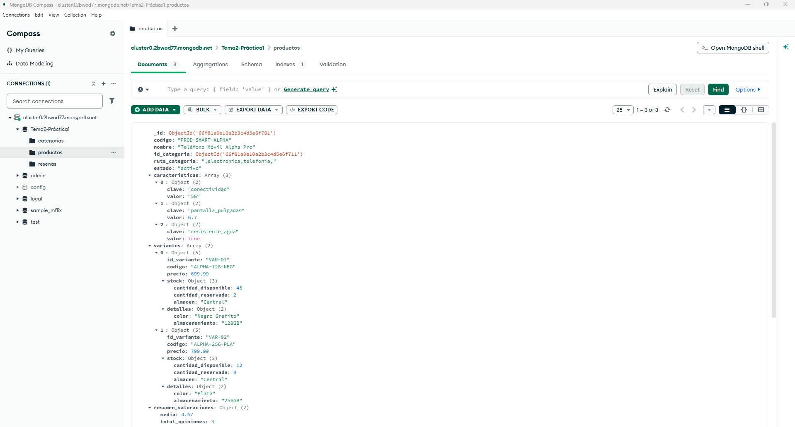
*Figura 2: Documento de producto desplegado en MongoDB mostrando variantes y stock.*

### Colección `resenas`
```json
{
  "_id": { "$oid": "66f81a0e10a2b3c4d5e6f801" },
  "id_producto": { "$oid": "66f81a0e10a2b3c4d5e6f701" },
  "id_usuario": { "$oid": "66f81a0e10a2b3c4d5e6f901" },
  "puntuacion": 5,
  "titulo": "Increíble batería y pantalla",
  "comentario": "Dura más de un día completo de uso continuo.",
  "fecha_creacion": { "$date": "2026-08-15T10:30:00Z" }
}
```

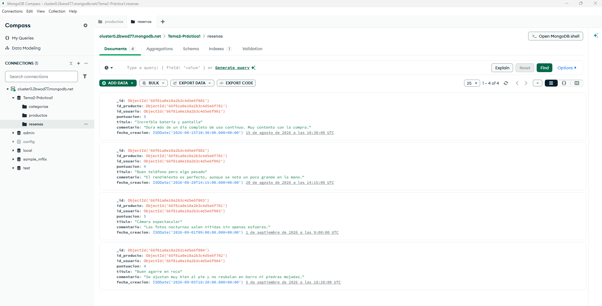
*Figura 3: Documentos de reseñas vinculadas mediante id_producto.*

## 3. Justificación de Decisiones de Modelado

### Decisión de Incrustación: Variantes y Stock dentro de `productos`
* **Tamaño y cardinalidad:** Relación 1:N acotada (entre 1 y 20 variantes por producto). El documento final ocupa menos de 15 KB, muy lejos del límite físico de 16 MB.
* **Frecuencia de lectura:** Muy alta (~90% del tráfico). Al abrir una ficha, el cliente necesita consultar a la vez opciones comerciales, precios y existencias. Al estar incrustado se recupera todo en una sola lectura, eliminando la necesidad de realizar cruces con `$lookup`.
* **Posibilidad de actualización:** Alta para el stock. Permite restar existencias de forma atómica y consistente con un único operador `$inc` condicional:
  ```javascript
  db.productos.updateOne(
    { "variantes.codigo": "ALPHA-128-NEG", "variantes.stock.cantidad_disponible": { $gte: 1 } },
    { $inc: { "variantes.$.stock.cantidad_disponible": -1 } }
  );
  ```

### Decisión de Referencia: `resenas` hacia `productos`
* **Tamaño y cardinalidad:** Relación 1:N no acotada. Un producto puede acumular decenas de miles de opiniones; incrustarlas provocaría desbordamiento del límite de 16 MB y saturaría la memoria de trabajo.
* **Frecuencia de lectura:** En listados generales solo se consulta la media (guardada en `resumen_valoraciones`). Los comentarios completos solo se leen de forma paginada en la vista de detalle.
* **Posibilidad de actualización:** Inserciones individuales por compradores. No provocan contención de escritura sobre el documento del producto.

## 4. Estrategia de Identificadores, Fechas, Estados y Campos Variables

* **Identificadores:** `ObjectId` nativo de 12 bytes para la clave primaria `_id` y códigos de texto únicos (`codigo`) como identificadores comerciales (SKU) para productos y variantes.
* **Fechas:** Formato nativo `ISODate` en UTC (`fecha_creacion`), permitiendo ordenar opiniones de forma cronológica directa y realizar filtros temporales.
* **Estados:** Campo enumerado controlado (`estado: "activo" | "borrador" | "archivado"`), evitando banderas booleanas dispersas.
* **Campos variables:** Lista de pares `{ clave, valor }` dentro de `caracteristicas`, permitiendo fichas técnicas heterogéneas sin campos vacíos ni valores nulos.

## 5. Límites y Compromisos del Modelo

* **Tamaño del documento:** Protegido frente al límite de 16 MB al aislar las opiniones en una colección independiente.
* **Crecimiento de arrays:** El array de variantes solo crece por acción administrativa al registrar nuevas tallas/colores, manteniendo un tamaño predecible.
* **Duplicación y consistencia:** El campo `resumen_valoraciones` en el producto actúa como caché desnormalizada. Requiere actualización periódica mediante agregación cuando entran nuevas reseñas.
* **Operación incómoda:** Para calcular el stock total de todo el catálogo, se requiere utilizar la etapa `$unwind` en un pipeline de agregación para desglosar el array de variantes antes de acumular.

---
---

# Actividad 3: Implementar Validación e Índices

## 1. Validación de Colecciones mediante `$jsonSchema`

Se han implementado esquemas de validación estrictos en el script `scripts/01-colecciones-validacion.js` aplicando `validationLevel: "strict"` y `validationAction: "error"` sobre las tres colecciones del catálogo:

* **Tipos BSON comprobados:** Uso de `objectId` para identificadores y referencias foráneas, `string` para códigos y textos descriptivos, `int` para contadores de opiniones y unidades de existencias, `number` para importes y calificaciones, `array` para listas y `date` para marcas temporales UTC.
* **Campos obligatorios:**
  * `categorias`: `codigo`, `nombre` y `ruta_jerarquia`.
  * `productos`: `codigo`, `nombre`, `id_categoria`, `estado` y el array `variantes` (con al menos un elemento mediante `minItems: 1`).
  * `resenas`: `id_producto`, `id_usuario`, `puntuacion` y `fecha_creacion`.
* **Enumeraciones (`enum`):** El ciclo de vida de un producto queda restringido en `estado` estrictamente a los valores `["activo", "borrador", "archivado"]`.
* **Restricción de rango y formato:**
  * **Rangos numéricos:** En `productos`, el precio debe ser superior a cero (`minimum: 0.01`) y el stock disponible no puede ser negativo (`minimum: 0`). En `resenas`, la puntuación se acota entre 1 y 5 (`minimum: 1, maximum: 5`).
  * **Formatos mediante expresiones regulares (`pattern`):** En `categorias`, el código exige el formato `^CAT-[A-Z0-9]+$` y la jerarquía `^,.*,$`. En `productos`, el código comercial exige `^PROD-[A-Z0-9-]+$`.

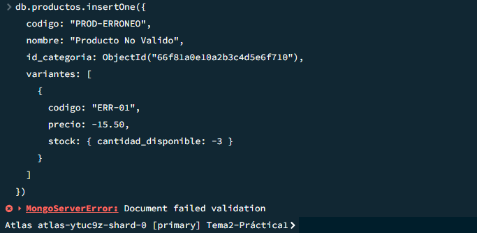  
*Figura 4: Rechazo atómico de inserción al violar las restricciones de esquema con Document failed validation.*

## 2. Definición de Índices según Preguntas de Negocio

A partir de los patrones de acceso identificados, se han creado los siguientes índices en el script `scripts/03-indices.js`:

1. **`idx_productos_estado_ruta_media` (Compuesto en `productos`):**  
   `{ estado: 1, ruta_categoria: 1, "resumen_valoraciones.media": -1 }`
2. **`idx_productos_variantes_sku_unique` (Multikey + Único en `productos`):**  
   `{ "variantes.codigo": 1 }`
3. **`idx_productos_estado_stock_critico` (Multikey Compuesto en `productos`):**  
   `{ estado: 1, "variantes.stock.cantidad_disponible": 1 }`
4. **`idx_productos_texto_busqueda` (Texto en `productos`):**  
   `{ nombre: "text", "caracteristicas.valor": "text" }`
5. **`idx_resenas_producto_fecha` (Compuesto en `resenas`):**  
   `{ id_producto: 1, fecha_creacion: -1 }`

## 3. Justificación de Índices: Consultas, Orden y Costes

* **`idx_productos_estado_ruta_media`:**
  * **Consulta que acelera:** **P1** (Listar productos activos de una categoría ordenados por calificación media).
  * **Orden de campos (Regla ESR):** Aplica la regla *Equality, Sort, Range*. Primero filtra por igualdad fija (`estado`), luego por prefijo de categoría jerárquica (`ruta_categoria`) y finalmente entrega los datos ordenados directamente desde el índice por `resumen_valoraciones.media`, eliminando la ordenación en memoria RAM (*SORT stage*).
  * **Coste en escrituras y almacenamiento:** Coste **medio**. Requiere actualizar el árbol B-Tree al crear productos o modificar su nota media. Su tamaño en disco es proporcional al catálogo.
* **`idx_productos_variantes_sku_unique`:**
  * **Consulta que acelera:** **P2 y P3** (Búsqueda directa por SKU y validación/descuento de existencias al comprar).
  * **Orden de campos:** Indexa el campo anidado `variantes.codigo`. Al ser multikey con `unique: true`, garantiza que no se repitan SKUs en toda la tienda.
  * **Coste en escrituras y almacenamiento:** Coste **medio-alto**. Genera tantas claves en el índice como variantes contenga cada documento.
* **`idx_productos_estado_stock_critico`:**
  * **Consulta que acelera:** **P5** (Reporte de variantes activas con existencias críticas $\le 5$).
  * **Orden de campos:** Filtra por igualdad sobre artículos a la venta (`estado`) y navega por el rango de unidades disponibles de menor a mayor.
  * **Coste en escrituras y almacenamiento:** Coste **alto**. Como el stock cambia tras cada compra con `$inc`, cada venta obliga al motor WiredTiger a recolocar la clave en el árbol del índice.
* **`idx_productos_texto_busqueda`:**
  * **Consulta que acelera:** Búsqueda libre por términos generales (ej. `"5G"`, `"Alpha"`, `"trail"`).
  * **Orden de campos:** Índice de texto sobre `nombre` y las especificaciones técnicas en `caracteristicas.valor`, con diccionario en español para omitir palabras vacías (*stop-words*).
  * **Coste en escrituras y almacenamiento:** Coste **alto**. Es la estructura más pesada en disco y penaliza los tiempos de inserción de productos.
* **`idx_resenas_producto_fecha`:**
  * **Consulta que acelera:** **P4** (Últimas reseñas de un producto ordenadas cronológicamente).
  * **Orden de campos:** Combina igualdad sobre el producto consultado (`id_producto`) con orden temporal inverso precalculado (`fecha_creacion`), permitiendo devolver comentarios paginados sin consumo de RAM.
  * **Coste en escrituras y almacenamiento:** Coste **bajo**. Las opiniones se insertan una única vez y no sufren actualizaciones.

## 4. Evidencia del Plan de Consulta con `explain("executionStats")`

Para comprobar el impacto del índice compuesto en la consulta **P4**, se ejecutó el planificador sobre:
```javascript
db.resenas.find({ id_producto: ObjectId("66f81a0e10a2b3c4d5e6f701") })
  .sort({ fecha_creacion: -1 })
```

* **Plan antes de aplicar el índice (`COLLSCAN` + `SORT`):**  
  El motor debe realizar un escaneo secuencial de toda la colección (`stage: "COLLSCAN"`), inspeccionando todos los registros existentes. Además, debe retener y ordenar los datos en memoria principal (`stage: "SORT"`), lo cual satura la RAM a medida que crecen las reseñas.

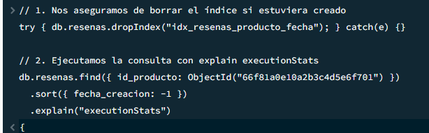
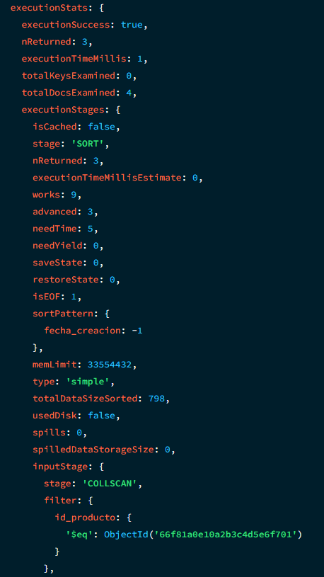  
*Figura 5: Consulta no indexada con escaneo completo (COLLSCAN) y ordenación en memoria (SORT).*

* **Plan después de aplicar el índice `idx_resenas_producto_fecha` (`IXSCAN` + `FETCH`):**  
  El motor localiza directamente las claves ordenadas en el árbol B-Tree mediante un escaneo de índice (`stage: "IXSCAN"`) y solo lee de disco los documentos coincidentes (`stage: "FETCH"`). La etapa `SORT` desaparece por completo (*zero in-memory sort*), optimizando el tiempo de respuesta.

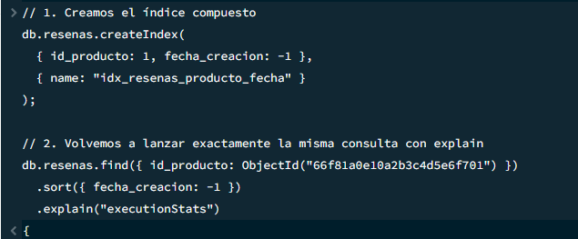 
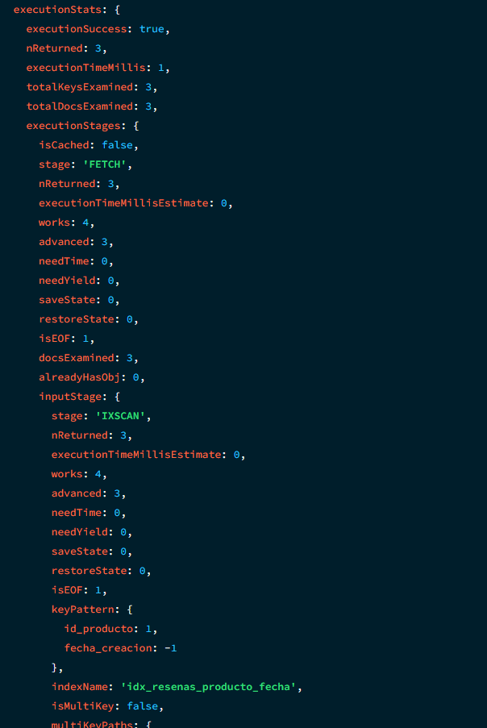  
*Figura 6: Consulta optimizada mediante escaneo por índice (IXSCAN) y sin etapa de ordenación en RAM.*

---
---

# Actividad 4: Resolver Consultas y Agregación Compleja

Todas las consultas y pipelines descritos a continuación se encuentran implementados de forma reproducible en el script `scripts/04-consultas.js`.

## 1. Operaciones CRUD (Inserción, Actualización Parcial y Desactivación Lógica)

* **Inserción (`insertOne`):** Se da de alta un producto técnico (`PROD-AURIC-NOISE`) con su matriz de variantes, stock inicializado y características flexibles.
* **Actualización Parcial Atómica (`updateOne` con `$set` e `$inc`):** Se rebaja el precio de una variante concreta y se incrementa en 10 unidades su disponibilidad de stock sin necesidad de sobreescribir el resto del documento:
  ```javascript
  db.productos.updateOne(
    { codigo: "PROD-AURIC-NOISE", "variantes.codigo": "AUR-PRO-NEG" },
    {
      $set: { "variantes.$.precio": 139.99 },
      $inc: { "variantes.$.stock.cantidad_disponible": 10 }
    }
  );
  ```
* **Desactivación Lógica:** Para preservar la integridad referencial histórica con posibles transacciones o registros previos, el producto no se elimina físicamente con `deleteOne`. En su lugar, se actualiza su ciclo de vida a `"archivado"`:
  ```javascript
  db.productos.updateOne(
    { codigo: "PROD-AURIC-NOISE" },
    { $set: { estado: "archivado" } }
  );
  ```

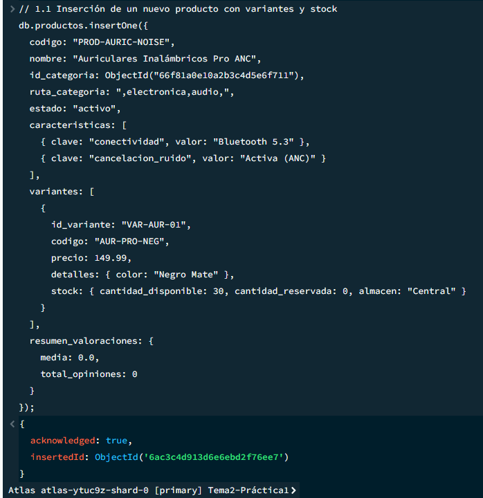  
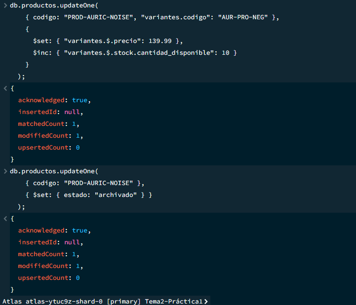  
*Figura 7: Evidencia de inserción, actualización parcial con $set/$inc y desactivación lógica.*

## 2. Filtros Combinados, Ordenación y Paginación Estable

Se implementa la navegación de catálogo (**P1**) aplicando un filtro compuesto por estado activo, categoría jerárquica y precio máximo de variante:

```javascript
db.productos.find(
  {
    estado: "activo",
    ruta_categoria: /^,electronica,/,
    "variantes.precio": { $lte: 700.0 }
  },
  {
    nombre: 1,
    codigo: 1,
    ruta_categoria: 1,
    "resumen_valoraciones.media": 1,
    "variantes.precio": 1
  }
)
.sort({ "resumen_valoraciones.media": -1, _id: 1 })
.skip(0)
.limit(2);
```

* **Paginación Estable:** El criterio de ordenación añade `_id: 1` como regla de desempate determinista. Esto asegura que si varios artículos comparten idéntica valoración media, no bailen entre páginas al avanzar con `skip` y `limit`.

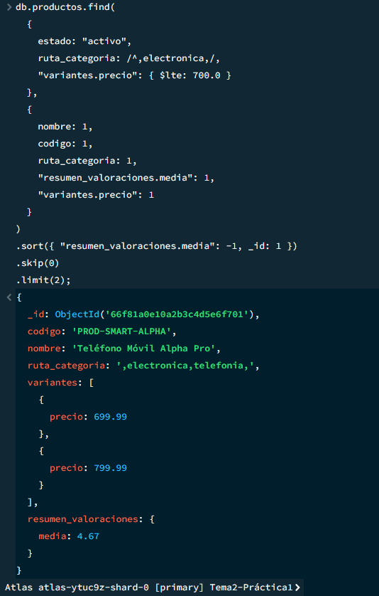  
*Figura 8: Resultado paginado de dos documentos con ordenación determinista.*

## 3. Consulta con Referencia Mediante `$lookup`

Para reconstruir la vista completa de producto con sus comentarios (**P2 + P4**), se ejecuta un cruce referencial entre `productos` y la colección externa `resenas`:

```javascript
db.productos.aggregate([
  { $match: { codigo: "PROD-SMART-ALPHA" } },
  {
    $lookup: {
      from: "resenas",
      localField: "_id",
      foreignField: "id_producto",
      as: "opiniones_clientes"
    }
  },
  {
    $project: {
      codigo: 1,
      nombre: 1,
      estado: 1,
      total_opiniones_registradas: { $size: "$opiniones_clientes" },
      opiniones_clientes: {
        puntuacion: 1,
        titulo: 1,
        comentario: 1,
        fecha_creacion: 1
      }
    }
  }
]);
```

Esta operación combina la velocidad de lectura del producto con la carga bajo demanda de sus opiniones, resolviendo la unión sobre el índice `{ id_producto: 1 }`.

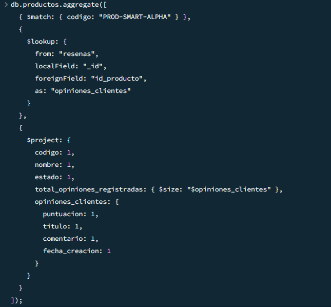  
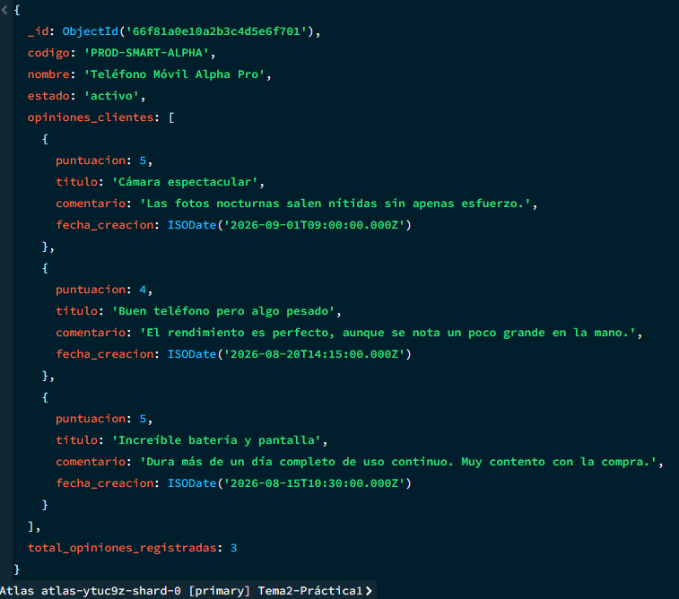  
*Figura 9: Documento enriquecido mediante $lookup con el array de opiniones asociadas.*

## 4. Agregación Compleja de 4+ Etapas con `$facet`

Para el panel logístico y financiero (**P5 + P6**), se construye un pipeline con desanidado y bifurcación paralela:

```javascript
db.productos.aggregate([
  // Etapa 1: Filtrado de activos
  { $match: { estado: "activo" } },

  // Etapa 2: Desanidado de variantes
  { $unwind: "$variantes" },

  // Etapas 3 y 4: Ramificación analítica simultánea
  {
    $facet: {
      valor_inventario_categoria: [
        {
          $group: {
            _id: "$ruta_categoria",
            unidades_totales: { $sum: "$variantes.stock.cantidad_disponible" },
            valor_economico: {
              $sum: {
                $multiply: [
                  "$variantes.stock.cantidad_disponible",
                  "$variantes.precio"
                ]
              }
            }
          }
        },
        { $sort: { valor_economico: -1 } }
      ],
      alerta_reposicion_urgente: [
        { $match: { "variantes.stock.cantidad_disponible": { $lte: 5 } } },
        {
          $project: {
            _id: 0,
            producto: "$nombre",
            codigo_variante: "$variantes.codigo",
            almacen: "$variantes.stock.almacen",
            unidades_restantes: "$variantes.stock.cantidad_disponible"
          }
        }
      ]
    }
  }
]);
```

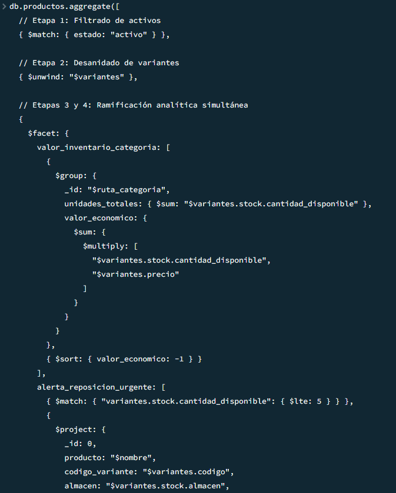  
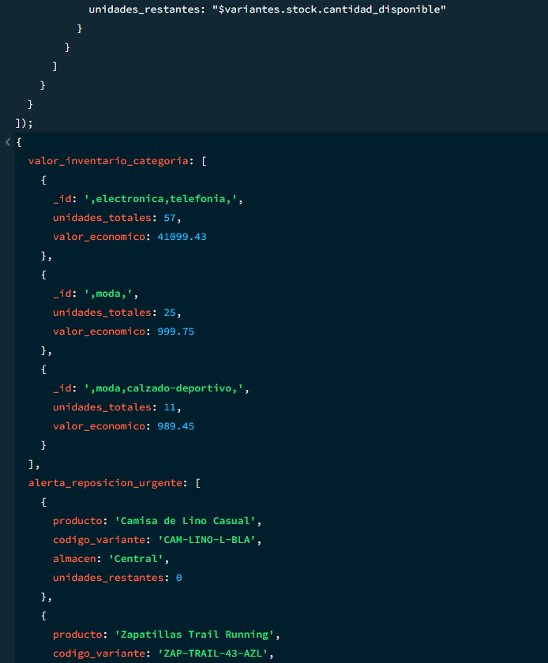  
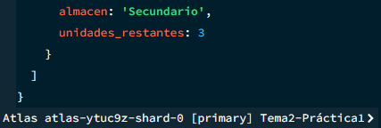  
*Figura 10: Ejecución de agregación compleja con $facet mostrando inventario valorado y reposición crítica.*

## 5. Explicación del Resultado y Análisis de Escalabilidad

* **Interpretación del Resultado:**  
  La agregación devuelve un único documento raíz con dos arrays calculados en una sola pasada:
  * `valor_inventario_categoria`: Totaliza el capital retenido en almacén agrupado por rama jerárquica de categoría, ordenado de mayor a menor valor económico.
  * `alerta_reposicion_urgente`: Lista las referencias exactas con existencias disponibles $\le 5$, permitiendo una acción de compras inmediata.

* **Impacto en el Coste al Aumentar los Datos:**
  * **Eficiencia de `$facet`:** Procesa las dos consultas en un único recorrido por los datos en memoria, evitando lecturas duplicadas de disco.   * **Coste del `$unwind`:** Multiplica el volumen de documentos intermedios en proporción al número de variantes. En catálogos con millones de variantes, esta etapa genera un alto consumo transitorio de CPU y memoria.
  * **Límite de memoria (100 MB):** El filtro inicial `$match` es esencial para reducir el conjunto de documentos antes del `$unwind`. Si el volumen de datos supera el límite de 100 MB por etapa, se debe habilitar la opción `{ allowDiskUse: true }`.

---
---

# Actividad 5: Copias de Seguridad, Seguridad y Límites

## 1. Procedimiento de Copia y Restauración con `mongodump` y `mongorestore`

La estrategia de respaldo lógico se basa en volcados BSON consistentes ejecutados desde la línea de comandos del sistema operativo:

* **Comando de Copia de Seguridad (`mongodump`):**
  ```bash
  mongodump --uri="mongodb+srv://cluster0.example.mongodb.net/tienda_online" \
    --username "admin_mantenimiento" \
    --gzip \
    --out=./backups/backup_$(date +%Y%m%d)
  ```
  El modificador `--gzip` comprime el tráfico de red y el almacenamiento resultante. El proceso realiza lecturas consistentes de los metadatos y documentos sin bloquear las lecturas de los usuarios en producción.

* **Comando de Restauración (`mongorestore`):**
  ```bash
  mongorestore --uri="mongodb+srv://cluster0.example.mongodb.net/tienda_online" \
    --username "admin_mantenimiento" \
    --gzip \
    --drop \
    --dir=./backups/backup_20261005/tienda_online
  ```
  La directiva `--drop` borra las colecciones destino antes de volcar los datos, garantizando una restauración idéntica y evitando duplicados por colisión de `_id`.

* **Alternativa nativa en MongoDB Atlas:**  
  En entornos de producción sobre Atlas, la solución preferente es el sistema integrado de **Cloud Backups (Snapshots)**. Este mecanismo aprovecha instantáneas a nivel de almacenamiento EBS/disco cada pocas horas con retención programada y ofrece **Point-in-Time Recovery (PITR)**, lo que permite restaurar el clúster a cualquier segundo exacto de los últimos 7 días reproduciendo los registros del *oplog*.

## 2. Usuarios, Roles y Permisos Mínimos (RBAC)

Siguiendo el principio de menor privilegio (*least privilege*), se aíslan las funciones operativas del sistema:

* **Usuario de Aplicación (`app_tienda_backend`):**
  * **Rol asignado:** `readWrite` acotado exclusivamente a la base de datos `tienda_online`.
  * **Justificación:** La capa de servicio solo requiere consultar catálogo, registrar reseñas y actualizar unidades de stock. Carece de permisos sobre la base de datos `admin`, impidiendo que una inyección o brecha en la aplicación web permita modificar usuarios, alterar esquemas de validación o borrar bases de datos.
* **Usuario de Mantenimiento y Backups (`admin_mantenimiento`):**
  * **Roles asignados:** `dbAdmin` sobre `tienda_online`, y `backup` / `restore` sobre la base de datos `admin`.
  * **Justificación:** Este usuario se emplea para tareas programadas de mantenimiento, gestión de índices y ejecución de volcados lógicos. Requiere autenticación de doble factor (2FA en Atlas) y restricción de acceso por lista blanca de direcciones IP.

## 3. Cifrado, Anonimización y Exclusión de Datos en Pruebas

* **Datos a Cifrar:**
  * **En tránsito:** Obligatoriedad de conexiones cifradas TLS/SSL (versión 1.3) para cualquier cliente que se conecte al clúster.
  * **En reposo:** Cifrado transparente del motor de almacenamiento WiredTiger (AES-256) activo en MongoDB Atlas, protegiendo tanto los archivos de base de datos como las instantáneas de copia de seguridad.
* **Datos a Anonimizar en Entornos de Prueba:**
  * En la colección `resenas`, aunque el comprador se identifica mediante un `id_usuario` seudonimizado, los campos textuales `comentario` y `titulo` deben someterse a filtros de enmascaramiento antes de exportar datos a desarrollo, reemplazando correos electrónicos, nombres o teléfonos introducidos por los clientes por cadenas genéricas para cumplir con el RGPD.
* **Datos a Excluir:**
  * Si existieran colecciones de auditoría de accesos o registros de intentos de sesión, deben excluirse por completo mediante el parámetro `--excludeCollection` durante la extracción del volcado para pruebas.

## 4. Situaciones donde MongoDB No es la Mejor Opción

1. **Recomendaciones Basadas en Redes Complejas y Grafos:**  
   Si el comercio requiere un motor de recomendación avanzado basado en relaciones profundas ("clientes que compraron X también compraron lo que compraron los amigos de Y"), resolver múltiples saltos en MongoDB exigiría encadenar operadores `$lookup` o `$graphLookup` de alto coste computacional. Una base de datos orientada a grafos como **Neo4j** es el sistema especializado óptimo para consultas de alta conectividad.
2. **Contabilidad Financiera y Asientos de Doble Partida:**  
   Para la conciliación de pagos entre múltiples cuentas bancarias, balances contables estrictos y pasarelas de liquidación que exigen control transaccional distribuido rígido y bloqueos deterministas a nivel de fila, un motor relacional como **PostgreSQL** proporciona herramientas nativas más robustas frente a modelos orientados a documentos.

## 5. Política de Conservación, Archivado y Eliminación de Datos

* **Conservación en Caliente:**
  * **`productos` y `categorias`:** Se conservan indefinidamente en MongoDB mientras estén activos o descatalogados para garantizar la integridad visual del catálogo histórico.
  * **`resenas`:** Se mantienen en la base de datos activa vinculadas al producto.
* **Archivado en Frío:**
  * Las opiniones asociadas a productos dados de baja definitiva hace más de 12 meses se exportan en lotes comprimidos a almacenamiento analítico externo (Data Lake en S3 / Parquet) para análisis histórico de tendencias, liberando espacio en el clúster activo.
* **Eliminación Automática:**
  * Los registros de auditoría efímeros o carritos temporales no finalizados se configuran con un índice de tiempo de vida (**TTL Index**) en un campo `fecha_expiracion` para que el propio motor de MongoDB los purgue automáticamente transcurridos 7 días sin intervención manual.