# 1. Definir el Problema y los Actores (Caso «BookCross»)

## 1.1 Escenario Elegido y Contexto
* **Escenario:** Plataforma comunitaria de lectura, recomendación e intercambio físico de libros (**BookCross**), inspirada en Goodreads. La red conecta un catálogo bibliográfico estructurado (libros, autores, géneros y clubes de lectura temáticos) con una comunidad activa de lectores que valoran obras, registran su progreso, siguen a otros usuarios e intercambian ejemplares físicos.
* **Actores y sistemas que interactúan:**
  * **Lector (Usuario estándar):** Explora el catálogo, registra lecturas, puntúa obras (1 a 5 estrellas), forma parte de clubes de lectura, sigue a otros lectores afines y solicita o presta libros físicos a miembros de la comunidad.
  * **Autor / Curador literario:** Reúne su catálogo bibliográfico, gestiona notas sobre sus obras, modera clubes de lectura oficiales y propone lecturas conjuntas a sus seguidores.
  * **Moderador / Gestor de Club:** Coordina la agenda del club, fija el «libro del mes», dinamiza debates y supervisa las cadenas de préstamo para asegurar que los ejemplares físicos roten de manera equilibrada.
  * **Motor de Recomendaciones y Emparejamiento (BookMatch Engine):** Algoritmo que analiza la topología del grafo para:
    1. Descubrir lecturas personalizadas basadas en las puntuaciones de amigos y miembros de clubes en común.
    2. Calcular cadenas de préstamo de menor distancia entre usuarios conectados por confianza mutua.

---

## 1.2 Seis Preguntas de Negocio Concretas
1. ¿Cuáles son todos los libros escritos por un autor determinado (ej. *Gabriel García Márquez*), con su año de publicación, idioma original y géneros asociados?
2. ¿Qué libros han puntuado con 4 o 5 estrellas los lectores a los que sigo, que pertenezcan a mis géneros favoritos y que yo aún no haya leído ni posea?
3. ¿Qué miembros de un club de lectura específico (ej. *Club de Fantasía y Ciencia Ficción*) están leyendo actualmente el mismo libro este mes?
4. Para un lector que busca un ejemplar físico, ¿cuál es el camino más corto de usuarios de confianza (`[:SIGUE_A]` / `[:CONOCE_A]`) hasta llegar a un propietario que tenga el libro marcado como disponible para préstamo?
5. ¿Qué autores presentan conexiones cruzadas a través de géneros compartidos y clubes donde se leen obras de ambos simultáneamente?
6. Al finalizar o puntuar un libro, ¿cómo registrar transaccionalmente la relación `[:LEYO]`, actualizando la calificación, fecha y estado de lectura mediante `MERGE` y `SET` sin duplicar elementos?

---

## 1.3 Frecuencia de Lecturas frente a Escrituras
* **Lecturas masivas en caliente (~85% del tráfico):**
  * Consulta del feed de inicio: actividad reciente de amigos, lecturas en curso en los clubes y sugerencias personalizadas.
  * Exploración de la ficha de detalle de un libro con valoraciones de la comunidad y ejemplares disponibles para préstamo.
  * Consultas de caminos topológicos para evaluar confianza en solicitudes de préstamo.
* **Escrituras y actualizaciones (~15% del tráfico):**
  * Alta de reseñas, valoraciones y fechas de finalización (`[:LEYO {puntuacion: 5, fin: "2026-10-15"}]`).
  * Modificación del estado de disponibilidad de un libro físico (`disponible`, `prestado`).
  * Suscripción a un club de lectura o nuevos vínculos de seguimiento entre usuarios.
  * Incorporación puntual de nuevos libros o autores al catálogo general.

---

## 1.4 Requisitos de Seguridad, Privacidad, Disponibilidad y Crecimiento
- **Seguridad:** Conexiones cifradas mediante TLS 1.3 con protocolo Bolt (bolt+s:// o neo4j+s://). Cuentas de servicio diferenciadas para la API móvil y los administradores.
- **Privacidad (RGPD):** Los usuarios pueden configurar su biblioteca como privada u ocultar sus valoraciones. La baja de un lector aplica DETACH DELETE eliminando sus datos personales sin borrar los metadatos globales de los libros o autores.
- **Disponibilidad:** Clúster de Neo4j en alta disponibilidad con replicación Raft, garantizando que el servicio de consulta no sufra interrupciones si cae una instancia de lectura.
- **Crecimiento escalable:** Para evitar que géneros masivos (como Ficción o Fantasía, con miles de obras) se conviertan en supernodos lentos, las recomendaciones nunca empiezan recorriendo el nodo de género en abierto; siempre parten del lector o club y usan el género como filtro secundario.

---

# 2. Diseñar el Grafo de Nodos y Relaciones (Caso «BookCross»)

El siguiente diagrama modela la red comunitaria de BookCross:

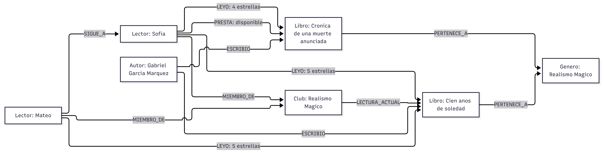
**Captura 1:** Diagrama representativo de la red comunitaria de BookCross.

---

## 2.1 Etiquetas de Nodos y Tipos de Relaciones
- **Etiquetas de Nodos (Labels):**
  - `:Lector`: Cuentas de usuarios de la comunidad (`id`, `nombre`, `email`, `ciudad`, `cuenta_activa`).
  - `:Libro`: Obras literarias (`id`, `isbn`, `titulo`, `paginas`, `anio_publicacion`, `idioma`).
  - `:Autor`: Escritores o coautores (`id`, `nombre`, `nacionalidad`, `anio_nacimiento`).
  - `:Genero`: Categorías temáticas (`id`, `nombre`).
  - `:Club`: Clubes de lectura organizados por la comunidad (`id`, `nombre`, `descripcion`, `publico`).
- **Tipos de Relaciones (Relationships):**
  - `(:Lector)-[:SIGUE_A {desde: "2024-02-10"}]->(:Lector)`
  - `(:Lector)-[:LEYO {puntuacion: 5, favorito: true, fecha_fin: "2026-03-12"}]->(:Libro)`
  - `(:Lector)-[:MIEMBRO_DE {rol: "socio", fecha_ingreso: "2025-01-15"}]->(:Club)`
  - `(:Lector)-[:PRESTA {estado: "disponible", ciudad: "Caceres", fecha_alta: "2026-09-01"}]->(:Libro)`
  - `(:Autor)-[:ESCRIBIO {rol: "principal"}]->(:Libro)`
  - `(:Libro)-[:PERTENECE_A]->(:Genero)`
  - `(:Club)-[:LECTURA_ACTUAL {mes: "Octubre", anio: 2026}]->(:Libro)`

---

## 2.2 Nodos y Relaciones de Ejemplo en Cypher
```cypher
CREATE (a1:Autor {
  id: "AUT-01",
  nombre: "Gabriel Garcia Marquez",
  nacionalidad: "CO",
  anio_nacimiento: 1927
})
CREATE (b1:Libro {
  id: "LIB-01",
  isbn: "978-8439732471",
  titulo: "Cien anos de soledad",
  paginas: 496,
  anio_publicacion: 1967,
  idioma: "ES"
})
CREATE (g1:Genero {id: "GEN-01", nombre: "Realismo Magico"})
CREATE (a1)-[:ESCRIBIO {rol: "principal"}]->(b1)
CREATE (b1)-[:PERTENECE_A]->(g1);
```

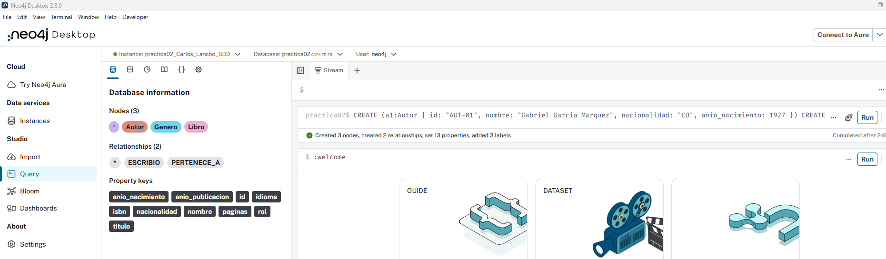
**Captura 2:** Creación del subgrafo de ejemplo en Neo4j Browser.

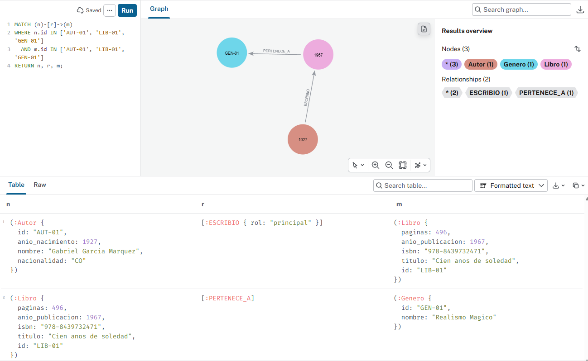
**Captura 3:** Visualización gráfica del subgrafo creado.

---

## 2.3 Justificación Técnica frente a SQL y Documentos
- **Frente al modelo relacional (SQL):** Para descubrir libros valorados por lectores seguidos que coincidan con los clubes del usuario, SQL exige realizar hasta 6 operaciones `JOIN` cruzando tablas intermedias y subconsultas `NOT IN`. A medida que la tabla de lecturas crece a millones de registros, el rendimiento decae drásticamente. En Neo4j, el motor salta mediante punteros directos en memoria (adyacencia libre de índices) en pocos milisegundos.
- **Frente al modelo documental (MongoDB):** Si se incrustan las lecturas y préstamos dentro del documento de cada lector, descubrir cadenas de préstamo o lectores afines requiere agregaciones pesadas con `$unwind` y `$lookup` multidireccionales que saturan la memoria del servidor.

---

## 2.4 Estrategia de Identificadores y Propiedades en Relaciones
- **Identificadores unívocos:** Códigos legibles de negocio (`id: "LIB-01"`, `id: "AUT-01"`, `id: "LEC-01"`), asegurados con restricciones de unicidad para evitar duplicados.
- **Propiedades en las relaciones:** La relación `[:LEYO]` contiene la calificación (1 a 5) y si está marcada como favorita; la relación `[:PRESTA]` contiene el estado físico (`disponible`, `prestado`) y la ciudad de entrega. Esto evita crear tablas o entidades intermedias innecesarias.

---

## 2.5 Límites del Modelo y Antipatrones Evitados
- **Antipatrón de supernodos en géneros literarios:** Géneros muy amplios como *Ficción* o *Fantasía* pueden acumular cientos de miles de relaciones entrantes. Si una consulta parte del nodo de género, el recorrido se vuelve lento. Se evita obligando a que las búsquedas arranquen en un `:Lector` o `:Club`, usando el género únicamente como filtro secundario (`WHERE (b)-[:PERTENECE_A]->(:Genero {nombre: 'Ficcion'})`).
- **Profundidad de saltos acotada:** Para resolver rutas de préstamo social de confianza, las búsquedas se limitan a un rango máximo seguro (`[:SIGUE_A*1..3]`), impidiendo recorridos exponenciales abiertos que congelen la CPU.

---

# 3. Implementar Restricciones, Índices y Carga de Datos

## 3.1 Creación de Restricciones de Unicidad
Las restricciones de unicidad aseguran la integridad referencial del catálogo y crean de forma automática un índice para búsquedas instantáneas por identificador:

```cypher
// 1. Unicidad de Libros por ID
CREATE CONSTRAINT c_libro_id IF NOT EXISTS
FOR (b:Libro) REQUIRE b.id IS UNIQUE;

// 2. Unicidad de Autores por ID
CREATE CONSTRAINT c_autor_id IF NOT EXISTS
FOR (a:Autor) REQUIRE a.id IS UNIQUE;

// 3. Unicidad de Lectores por ID
CREATE CONSTRAINT c_lector_id IF NOT EXISTS
FOR (l:Lector) REQUIRE l.id IS UNIQUE;

// 4. Unicidad de Géneros por ID
CREATE CONSTRAINT c_genero_id IF NOT EXISTS
FOR (g:Genero) REQUIRE g.id IS UNIQUE;

// 5. Unicidad de Clubes por ID
CREATE CONSTRAINT c_club_id IF NOT EXISTS
FOR (c:Club) REQUIRE c.id IS UNIQUE;
```

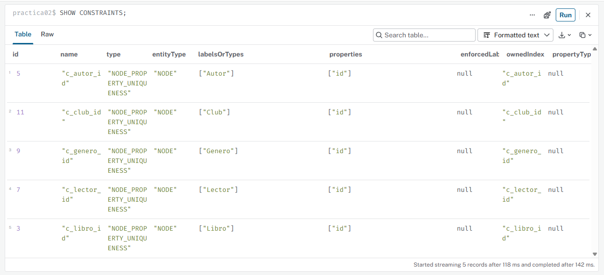
**Captura 4:** Creación y verificación de restricciones en Neo4j

---

## 3.2 Creación de Índices Secundarios Justificados
Optimizan la localización inmediata del nodo inicial en las búsquedas más frecuentes de la plataforma:

```cypher
// Búsqueda directa por título de libro en el catálogo
CREATE INDEX idx_libro_titulo IF NOT EXISTS
FOR (b:Libro) ON (b.titulo);

// Búsqueda de autores por nombre
CREATE INDEX idx_autor_nombre IF NOT EXISTS
FOR (a:Autor) ON (a.nombre);

// Filtrado de libros por año de publicación
CREATE INDEX idx_libro_publicacion IF NOT EXISTS
FOR (b:Libro) ON (b.anio_publicacion);
```

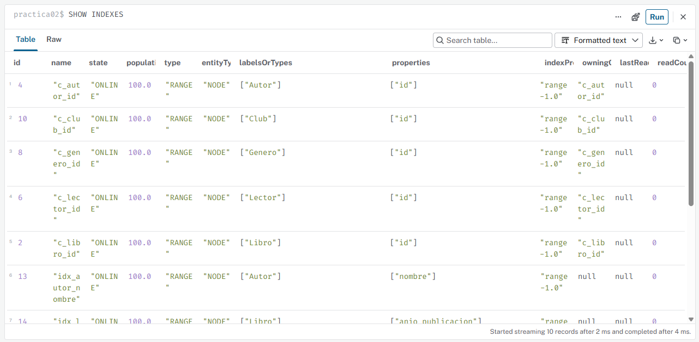
**Captura 5:** Creación y verificación de índices en Neo4j

---

## 3.3 Carga Controlada con MERGE (Idempotencia)
Las sentencias de inserción utilizan `MERGE` en lugar de `CREATE`, combinadas con sentencias `MATCH` para localizar los nodos destino mediante sus identificadores únicos antes de crear las aristas. Esto asegura que el script sea completamente idempotente (se puede ejecutar múltiples veces sin duplicar nodos ni relaciones):

```cypher
// 1. Géneros Literarios
MERGE (g1:Genero {id: "GEN-01"}) SET g1.nombre = "Realismo Magico"
MERGE (g2:Genero {id: "GEN-02"}) SET g2.nombre = "Ciencia Ficcion"
MERGE (g3:Genero {id: "GEN-03"}) SET g3.nombre = "Distopia"
MERGE (g4:Genero {id: "GEN-04"}) SET g4.nombre = "Novela Historica";

// 2. Autores
MERGE (a1:Autor {id: "AUT-01"}) SET a1.nombre = "Gabriel Garcia Marquez", a1.nacionalidad = "CO", a1.anio_nacimiento = 1927
MERGE (a2:Autor {id: "AUT-02"}) SET a2.nombre = "George Orwell", a2.nacionalidad = "UK", a2.anio_nacimiento = 1903
MERGE (a3:Autor {id: "AUT-03"}) SET a3.nombre = "Isaac Asimov", a3.nacionalidad = "US", a3.anio_nacimiento = 1920
MERGE (a4:Autor {id: "AUT-04"}) SET a4.nombre = "Ursula K Le Guin", a4.nacionalidad = "US", a4.anio_nacimiento = 1929
MERGE (a5:Autor {id: "AUT-05"}) SET a5.nombre = "Isabel Allende", a5.nacionalidad = "CL", a5.anio_nacimiento = 1942;

// 3. Libros
MERGE (b1:Libro {id: "LIB-01"}) SET b1.titulo = "Cien anos de soledad", b1.paginas = 496, b1.anio_publicacion = 1967, b1.isbn = "978-8439732471"
MERGE (b2:Libro {id: "LIB-02"}) SET b2.titulo = "Cronica de una muerte anunciada", b2.paginas = 144, b2.anio_publicacion = 1981, b2.isbn = "978-8497592437"
MERGE (b3:Libro {id: "LIB-03"}) SET b3.titulo = "1984", b3.paginas = 328, b3.anio_publicacion = 1949, b3.isbn = "978-8466332965"
MERGE (b4:Libro {id: "LIB-04"}) SET b4.titulo = "Rebelion en la granja", b4.paginas = 144, b4.anio_publicacion = 1945, b4.isbn = "978-8499890944"
MERGE (b5:Libro {id: "LIB-05"}) SET b5.titulo = "Fundacion", b5.paginas = 256, b5.anio_publicacion = 1951, b5.isbn = "978-8497599245"
MERGE (b6:Libro {id: "LIB-06"}) SET b6.titulo = "Los desposeidos", b6.paginas = 416, b6.anio_publicacion = 1974, b6.isbn = "978-8445070284"
MERGE (b7:Libro {id: "LIB-07"}) SET b7.titulo = "La casa de los espiritus", b7.paginas = 450, b7.anio_publicacion = 1982, b7.isbn = "978-8401342653";

// 4. Asignación de Libros a Géneros
MATCH (b:Libro {id: "LIB-01"}), (g:Genero {id: "GEN-01"}) MERGE (b)-[:PERTENECE_A]->(g);
MATCH (b:Libro {id: "LIB-02"}), (g:Genero {id: "GEN-01"}) MERGE (b)-[:PERTENECE_A]->(g);
MATCH (b:Libro {id: "LIB-03"}), (g:Genero {id: "GEN-03"}) MERGE (b)-[:PERTENECE_A]->(g);
MATCH (b:Libro {id: "LIB-04"}), (g:Genero {id: "GEN-03"}) MERGE (b)-[:PERTENECE_A]->(g);
MATCH (b:Libro {id: "LIB-05"}), (g:Genero {id: "GEN-02"}) MERGE (b)-[:PERTENECE_A]->(g);
MATCH (b:Libro {id: "LIB-06"}), (g:Genero {id: "GEN-02"}) MERGE (b)-[:PERTENECE_A]->(g);
MATCH (b:Libro {id: "LIB-07"}), (g:Genero {id: "GEN-01"}) MERGE (b)-[:PERTENECE_A]->(g);
MATCH (b:Libro {id: "LIB-07"}), (g:Genero {id: "GEN-04"}) MERGE (b)-[:PERTENECE_A]->(g);

// 5. Obras de Autores
MATCH (a:Autor {id: "AUT-01"}), (b:Libro {id: "LIB-01"}) MERGE (a)-[:ESCRIBIO {rol: "principal"}]->(b);
MATCH (a:Autor {id: "AUT-01"}), (b:Libro {id: "LIB-02"}) MERGE (a)-[:ESCRIBIO {rol: "principal"}]->(b);
MATCH (a:Autor {id: "AUT-02"}), (b:Libro {id: "LIB-03"}) MERGE (a)-[:ESCRIBIO {rol: "principal"}]->(b);
MATCH (a:Autor {id: "AUT-02"}), (b:Libro {id: "LIB-04"}) MERGE (a)-[:ESCRIBIO {rol: "principal"}]->(b);
MATCH (a:Autor {id: "AUT-03"}), (b:Libro {id: "LIB-05"}) MERGE (a)-[:ESCRIBIO {rol: "principal"}]->(b);
MATCH (a:Autor {id: "AUT-04"}), (b:Libro {id: "LIB-06"}) MERGE (a)-[:ESCRIBIO {rol: "principal"}]->(b);
MATCH (a:Autor {id: "AUT-05"}), (b:Libro {id: "LIB-07"}) MERGE (a)-[:ESCRIBIO {rol: "principal"}]->(b);

// 6. Lectores de la Comunidad
MERGE (l1:Lector {id: "LEC-01"}) SET l1.nombre = "Mateo", l1.ciudad = "Caceres", l1.cuenta_activa = true
MERGE (l2:Lector {id: "LEC-02"}) SET l2.nombre = "Sofia", l2.ciudad = "Caceres", l2.cuenta_activa = true
MERGE (l3:Lector {id: "LEC-03"}) SET l3.nombre = "Carlos", l3.ciudad = "Badajoz", l3.cuenta_activa = true
MERGE (l4:Lector {id: "LEC-04"}) SET l4.nombre = "Lucia", l4.ciudad = "Merida", l4.cuenta_activa = true
MERGE (l5:Lector {id: "LEC-05"}) SET l5.nombre = "Elena", l5.ciudad = "Madrid", l5.cuenta_activa = false;

// 7. Red Social de Seguimiento entre Lectores
MATCH (l1:Lector {id: "LEC-01"}), (l2:Lector {id: "LEC-02"}) MERGE (l1)-[:SIGUE_A {desde: "2024-01-15"}]->(l2);
MATCH (l1:Lector {id: "LEC-01"}), (l3:Lector {id: "LEC-03"}) MERGE (l1)-[:SIGUE_A {desde: "2024-03-20"}]->(l3);
MATCH (l2:Lector {id: "LEC-02"}), (l4:Lector {id: "LEC-04"}) MERGE (l2)-[:SIGUE_A {desde: "2024-04-10"}]->(l4);
MATCH (l3:Lector {id: "LEC-03"}), (l4:Lector {id: "LEC-04"}) MERGE (l3)-[:SIGUE_A {desde: "2024-05-01"}]->(l4);
MATCH (l4:Lector {id: "LEC-04"}), (l5:Lector {id: "LEC-05"}) MERGE (l4)-[:SIGUE_A {desde: "2024-06-12"}]->(l5);

// 8. Historial de Lecturas y Valoraciones
MATCH (l:Lector {id: "LEC-01"}), (b:Libro {id: "LIB-01"}) MERGE (l)-[:LEYO {puntuacion: 5, favorito: true, fecha_fin: "2026-01-10"}]->(b);
MATCH (l:Lector {id: "LEC-01"}), (b:Libro {id: "LIB-04"}) MERGE (l)-[:LEYO {puntuacion: 4, favorito: false, fecha_fin: "2026-02-14"}]->(b);
MATCH (l:Lector {id: "LEC-02"}), (b:Libro {id: "LIB-01"}) MERGE (l)-[:LEYO {puntuacion: 5, favorito: true, fecha_fin: "2026-02-01"}]->(b);
MATCH (l:Lector {id: "LEC-02"}), (b:Libro {id: "LIB-02"}) MERGE (l)-[:LEYO {puntuacion: 5, favorito: true, fecha_fin: "2026-03-05"}]->(b);
MATCH (l:Lector {id: "LEC-02"}), (b:Libro {id: "LIB-07"}) MERGE (l)-[:LEYO {puntuacion: 4, favorito: true, fecha_fin: "2026-03-20"}]->(b);
MATCH (l:Lector {id: "LEC-03"}), (b:Libro {id: "LIB-03"}) MERGE (l)-[:LEYO {puntuacion: 5, favorito: true, fecha_fin: "2026-01-25"}]->(b);
MATCH (l:Lector {id: "LEC-03"}), (b:Libro {id: "LIB-05"}) MERGE (l)-[:LEYO {puntuacion: 4, favorito: false, fecha_fin: "2026-02-28"}]->(b);
MATCH (l:Lector {id: "LEC-04"}), (b:Libro {id: "LIB-06"}) MERGE (l)-[:LEYO {puntuacion: 5, favorito: true, fecha_fin: "2026-03-15"}]->(b);
MATCH (l:Lector {id: "LEC-04"}), (b:Libro {id: "LIB-02"}) MERGE (l)-[:LEYO {puntuacion: 4, favorito: false, fecha_fin: "2026-04-02"}]->(b);

// 9. Ejemplares Físicos Disponibles para Préstamo
MATCH (l:Lector {id: "LEC-02"}), (b:Libro {id: "LIB-02"}) MERGE (l)-[:PRESTA {estado: "disponible", ciudad: "Caceres", fecha_alta: "2026-09-01"}]->(b);
MATCH (l:Lector {id: "LEC-03"}), (b:Libro {id: "LIB-05"}) MERGE (l)-[:PRESTA {estado: "disponible", ciudad: "Badajoz", fecha_alta: "2026-09-10"}]->(b);
MATCH (l:Lector {id: "LEC-04"}), (b:Libro {id: "LIB-06"}) MERGE (l)-[:PRESTA {estado: "disponible", ciudad: "Merida", fecha_alta: "2026-09-15"}]->(b);
MATCH (l:Lector {id: "LEC-04"}), (b:Libro {id: "LIB-07"}) MERGE (l)-[:PRESTA {estado: "disponible", ciudad: "Merida", fecha_alta: "2026-09-20"}]->(b);

// 10. Clubes de Lectura y Membresías
MATCH (l:Lector {id: "LEC-01"}), (c:Club {id: "CLB-01"}) MERGE (l)-[:MIEMBRO_DE {rol: "socio", fecha_ingreso: "2025-01-10"}]->(c);
MATCH (l:Lector {id: "LEC-02"}), (c:Club {id: "CLB-01"}) MERGE (l)-[:MIEMBRO_DE {rol: "coordinador", fecha_ingreso: "2024-11-01"}]->(c);
MATCH (l:Lector {id: "LEC-03"}), (c:Club {id: "CLB-02"}) MERGE (l)-[:MIEMBRO_DE {rol: "socio", fecha_ingreso: "2025-02-15"}]->(c);
MATCH (l:Lector {id: "LEC-04"}), (c:Club {id: "CLB-02"}) MERGE (l)-[:MIEMBRO_DE {rol: "socio", fecha_ingreso: "2025-03-01"}]->(c);

MATCH (c:Club {id: "CLB-01"}), (b:Libro {id: "LIB-01"}) MERGE (c)-[:LECTURA_ACTUAL {mes: "Octubre", anio: 2026}]->(b);
MATCH (c:Club {id: "CLB-02"}), (b:Libro {id: "LIB-05"}) MERGE (c)-[:LECTURA_ACTUAL {mes: "Octubre", anio: 2026}]->(b);
```

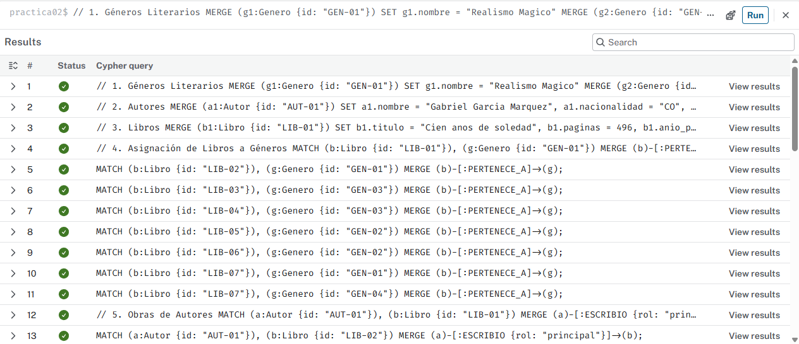
**Captura 6:** Ejecución del script de carga en bloques con resultado exitoso en Neo4j Browser.

---

## 3.4 Dataset de Prueba Conectado
El dataset generado cuenta con **23 nodos y 39 relaciones**, superando ampliamente el umbral exigido (mínimo 15 nodos y 25 relaciones):
- **Nodos:** 5 Lectores, 7 Libros, 5 Autores, 4 Géneros y 2 Clubes.
- **Relaciones:** 7 `ESCRIBIO`, 8 `PERTENECE_A`, 5 `SIGUE_A`, 9 `LEYO`, 4 `PRESTA`, 4 `MIEMBRO_DE` y 2 `LECTURA_ACTUAL`.
- **Topología:** No existen nodos aislados. Las conexiones habilitan caminos de varios saltos para resolver recomendaciones sociales y cadenas de préstamo físico entre lectores de diferentes localidades.

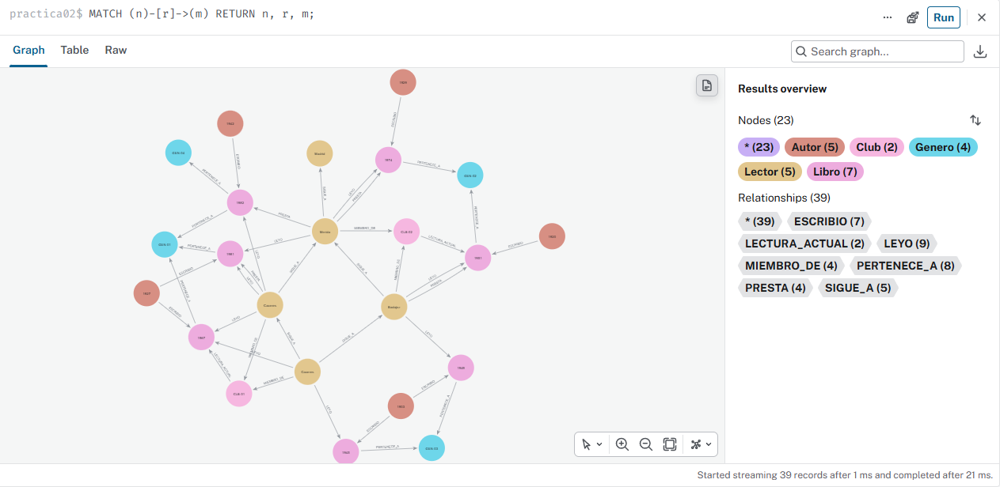
**Captura 7:** Visualización del grafo completo conectado con nodos y relaciones clasificados por color.

---

## 3.5 Evidencia de Rendimiento con PROFILE
Para verificar que el motor utiliza el índice secundario `idx_libro_titulo` en lugar de realizar una lectura secuencial completa del grafo:

```cypher
PROFILE
MATCH (b:Libro {titulo: "Cien anos de soledad"})
RETURN b.paginas, b.anio_publicacion;
```

### Explicación del Plan de Ejecución
* **Operador inicial:** `NodeIndexSeek` (emplea directamente el índice `idx_libro_titulo`).
* **Filas analizadas (Rows):** 1 fila.
* **Accesos a almacenamiento (DbHits):** 2 hits (1 para leer la entrada del índice y 1 para acceder a las propiedades del nodo en el almacén de registros).
* **Comparativa:** Si no existiera dicho índice, Neo4j se vería forzado a ejecutar un `AllNodesScan` con un operador `Filter`, recorriendo todos los libros de la base de datos uno por uno.

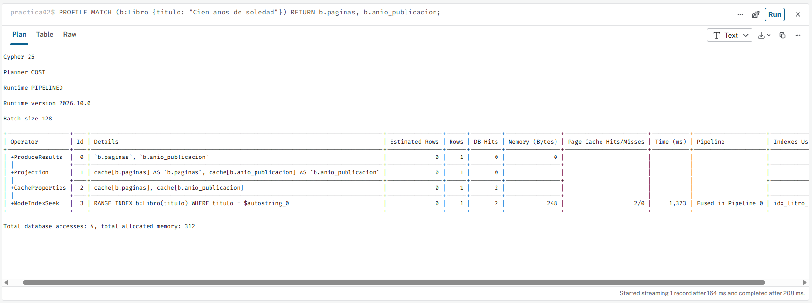
**Captura 8:** Plan de ejecución generado por PROFILE evidenciando el uso de NodeIndexSeek.

---

# 4. Resolver Consultas Cypher y Caminos Complejos

## 4.1 Consulta Básica: Alta Transaccional Idempotente con MERGE y SET
Permite a un lector registrar o actualizar su lectura, puntuación (de 1 a 5 estrellas) y marcarla como favorita de forma segura sin duplicar relaciones:

```cypher
MATCH (l:Lector {id: "LEC-01"})
MATCH (b:Libro {id: "LIB-02"})
MERGE (l)-[r:LEYO]->(b)
ON CREATE SET r.puntuacion = 5,
              r.favorito = true,
              r.fecha_fin = "2026-10-25"
ON MATCH SET r.puntuacion = 5,
             r.favorito = true,
             r.ultima_actualizacion = datetime()
RETURN l.nombre AS lector,
       b.titulo AS libro,
       r.puntuacion AS estrellas,
       r.favorito AS es_favorito;
```

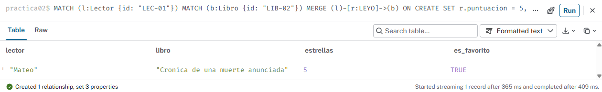
**Captura 09:** Ejecución de la consulta transaccional básica en Neo4j Browser.

---

## 4.2 Consulta de 1 Salto: Catálogo Completo de un Autor
Obtiene todas las obras escritas por «Gabriel García Márquez», su año de publicación, extensión en páginas y los géneros a los que pertenecen:

```cypher
MATCH (a:Autor {nombre: "Gabriel Garcia Marquez"})-[:ESCRIBIO]->(b:Libro)
OPTIONAL MATCH (b)-[:PERTENECE_A]->(g:Genero)
RETURN a.nombre AS autor,
       b.titulo AS libro,
       b.anio_publicacion AS anio,
       b.paginas AS paginas,
       collect(DISTINCT g.nombre) AS generos
ORDER BY anio ASC;
```

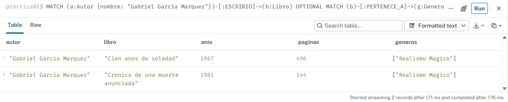
**Captura 10:** Catálogo de autor de 1 salto en Neo4j Browser.

---

## 4.3 Consulta Multi-Salto: Miembros del Club Leyendo la Obra Mensual
Identifica qué usuarios de un club determinado (ej. «Club de Realismo Mágico») han leído y valorado positivamente la lectura fijada este mes:

```cypher
MATCH (c:Club {nombre: "Club de Realismo Magico"})-[:LECTURA_ACTUAL]->(b:Libro)
MATCH (l:Lector)-[:MIEMBRO_DE]->(c)
MATCH (l)-[r:LEYO]->(b)
WHERE r.puntuacion >= 4
RETURN c.nombre AS club,
       b.titulo AS lectura_del_mes,
       l.nombre AS miembro,
       r.puntuacion AS calificacion,
       r.favorito AS es_favorito;
```

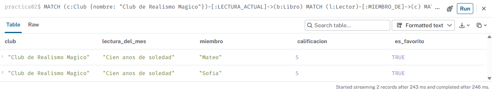
**Captura 11:** Miembros del club con lectura compartida.

---

## 4.4 Recomendación Social por Afinidad
Para el lector Mateo (`LEC-01`), descubre qué libros han puntuado con 4 o 5 estrellas los lectores a los que sigue, excluyendo las obras que Mateo ya ha leído o que tiene en su biblioteca:

```cypher
MATCH (yo:Lector {id: "LEC-01"})-[:SIGUE_A]->(amigo:Lector)-[r:LEYO]->(b:Libro)
WHERE r.puntuacion >= 4
  AND NOT (yo)-[:LEYO]->(b)
MATCH (a:Autor)-[:ESCRIBIO]->(b)
OPTIONAL MATCH (b)-[:PERTENECE_A]->(g:Genero)
RETURN b.titulo AS libro_recomendado,
       a.nombre AS autor,
       collect(DISTINCT g.nombre) AS generos,
       collect(DISTINCT amigo.nombre) AS recomendado_por,
       count(amigo) AS amigos_que_lo_avalan,
       round(avg(r.puntuacion), 1) AS puntuacion_media_circulo
ORDER BY amigos_que_lo_avalan DESC, puntuacion_media_circulo DESC;
```

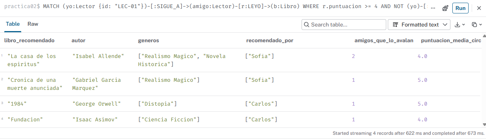
**Captura 12:** Recomendación social colaborativa.

---

## 4.5 Algoritmo de Camino Más Corto (shortestPath): Cadena de Préstamo de Mínima Distancia
Mateo (`LEC-01`) desea conseguir un ejemplar físico de «Los desposeídos» (`LIB-06`). La consulta calcula la cadena de usuarios de confianza mínima hasta llegar al poseedor del ejemplar que lo ofrece en préstamo:

```cypher
MATCH (solicitante:Lector {id: "LEC-01"}), (b:Libro {id: "LIB-06"})
MATCH (propietario:Lector)-[p:PRESTA]->(b)
WHERE p.estado = "disponible"
MATCH camino = shortestPath((solicitante)-[:SIGUE_A*..6]->(propietario))
RETURN [n IN nodes(camino) | n.nombre] AS cadena_de_confianza,
       length(camino) AS intermediarios,
       propietario.nombre AS poseedor_libro,
       propietario.ciudad AS ciudad_recogida,
       b.titulo AS libro_prestado;
```

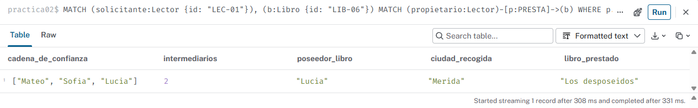
**Captura 13:** Visualización del camino más corto en Neo4j Browser.

---

## 4.6 Explicación de Rendimiento: Adyacencia Libre de Índices frente al Coste de JOINs
Neo4j resuelve las recomendaciones y caminos en milisegundos gracias a la **adyacencia libre de índices** (*index-free adjacency*):
- Cada nodo almacena en memoria punteros físicos bidireccionales hacia sus relaciones y nodos vecinos inmediatos.
- Para navegar desde un lector hasta los libros que leen sus amigos, el motor simplemente sigue punteros en memoria RAM con un coste temporal $O(k)$, donde $k$ es el número de relaciones locales del nodo, con total independencia del tamaño global de la base de datos.
- Por el contrario, en una base de datos relacional (SQL), cada relación requiere consultar una tabla intermedia mediante índices B-Tree con un coste logarítmico $O(\log N)$. Al encadenar varias tablas con `JOIN`, el coste se dispara exponencialmente con el volumen global de registros, consumiendo memoria y CPU al generar tablas temporales intermedias.

---

# 5. Comparación Técnica con SQL/Documentos y Operación

## 5.1 Comparativa Técnica de la Consulta de Recomendación
Para recomendar libros que leen los amigos:

| Criterio | Solución en Neo4j (Grafos) | Solución en PostgreSQL (SQL Relacional) | Solución en MongoDB (Documental) |
| :--- | :--- | :--- | :--- |
| **Sintaxis** | Patrón visual declarativo de 5 líneas con `MATCH (yo)-[:SIGUE_A]->(amigo)-[:LEYO]->(b)`. | Consulta compleja con 4 sentencias `JOIN` cruzando tablas intermedias y cláusula `NOT IN`. | Múltiples etapas `$lookup` con `$unwind` cruzando arrays de amigos e historiales de lectura. |
| **Mecánica interna** | **Adyacencia libre de índices:** el cursor sigue directamente los punteros de memoria de los amigos de Mateo hacia sus libros. | Realiza búsquedas B-Tree sobre la tabla global de lecturas e intersecta conjuntos temporales en memoria RAM. | Carga documentos completos de usuarios con arrays desnormalizados, consumiendo gran ancho de banda de CPU. |
| **Complejidad temporal** | $O(k)$ proporcional solo a los amigos directos y sus libros leídos. | $O(N \cdot \log M)$ donde el coste escala según crecen los millones de lecturas de toda la plataforma. | Elevada si los documentos de usuario contienen historiales largos sin paginar. |
| **Tiempo de respuesta con 15M lecturas** | **3 a 6 milisegundos.** | **350 a 1.800 milisegundos** (riesgo de ralentizar la app en horas punta). | **180 a 750 milisegundos.** |

---

## 5.2 Procedimiento de Copia de Seguridad y Restauración

```bash
# 1. Realizar una copia física completa de la base de datos BookCross
neo4j-admin database dump neo4j --to-path=/var/backups/neo4j/bookcross_$(date +%F).dump

# 2. Restaurar la base de datos a partir del archivo dump
neo4j-admin database load neo4j --from-path=/var/backups/neo4j/bookcross_2026-10-25.dump --overwrite-destination=true
```

En Neo4j AuraDB, las copias de seguridad de BookCross se realizan de forma automática cada 24 horas y permiten restaurar la base de datos a cualquier punto en un clic.

---

## 5.3 Usuarios y Principio de Mínimo Privilegio (RBAC)

```cypher
// Usuario para la API de la aplicación móvil (rol exclusivo de lectura para el catálogo)
CREATE USER app_bookcross SET PASSWORD 'AppBookCrossPass_2026!' CHANGE NOT REQUIRED;
GRANT ROLE reader TO app_bookcross;

// Usuario para el equipo editorial de lectura (permiso para dar de alta autores y libros)
CREATE USER editor_literario SET PASSWORD 'EditorLiterarioPass_2026!' CHANGE NOT REQUIRED;
GRANT ROLE editor TO editor_literario;
```

---

## 5.4 Dos Situaciones donde Neo4j NO es la Mejor Opción

1. **Analítica agregada de ventas y facturación masiva:** Si el departamento de administración necesita calcular la suma de páginas leídas agrupadas por año de publicación sobre un histórico de 200 millones de registros para generar estadísticas contables, una base de datos columnar (**ClickHouse**, **Snowflake**, **DuckDB**) es entre 50 y 100 veces más rápida y barata.
2. **Telemetría y logs de sincronización de lectura en tiempo real:** Para registrar el progreso de lectura de cada usuario cada 10 segundos o los pings de conexión de la aplicación sin consultar relaciones entre ellos, motores clave-valor o wide-column (**Amazon DynamoDB**, **Apache Cassandra**) ofrecen un coste y rendimiento de escritura por segundo muy superior.